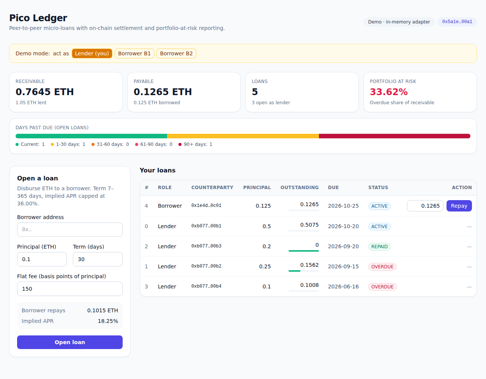
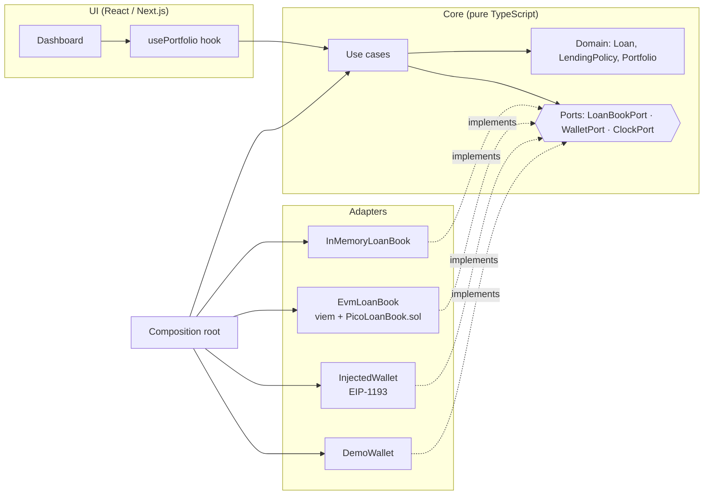
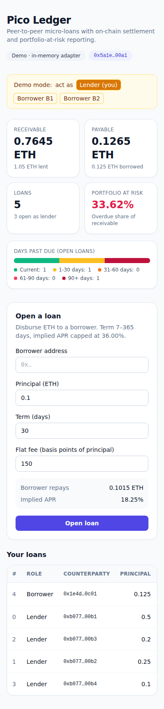

# Pico Ledger

Peer-to-peer micro-loans with on-chain settlement. A lender disburses ETH to a borrower in one transaction; the borrower repays principal plus a flat fee, in instalments, straight to the lender. The dashboard shows the book the way a credit-risk team would read it: receivables, portfolio-at-risk, and days-past-due buckets.

**Stack:** Next.js 14 (App Router) · React 18 · TypeScript (strict) · Tailwind CSS · viem · Solidity 0.8 · Vitest · Anvil



## Why this project

I run a licensed pico-finance lending business in Thailand, so the domain rules here are real ones: a hard cap on annualised rate, bounded terms, and portfolio-at-risk as the headline health metric. I wanted to see how those rules hold up when settlement moves on-chain, and how to structure a frontend so the business logic doesn't get tangled up with wallets and ABIs.

## Architecture: hexagonal (ports & adapters)



```
src/
  core/                 # no React, no viem, no browser APIs
    domain/             # Loan maths, LendingPolicy (Result-typed validation), portfolio/PAR
    ports/              # LoanBookPort, WalletPort, ClockPort
    usecases/           # openLoan, repayLoan, loadPortfolio
  adapters/
    in-memory/          # zero-setup demo + reference behaviour
    evm/                # viem adapter over the PicoLoanBook contract (+ generated ABI)
    wallet/             # EIP-1193 injected wallet, demo wallet
    clock/
  composition/          # the ONLY place that picks concrete adapters
  ui/                   # components, hooks, formatting — talks to use cases only
contracts/PicoLoanBook.sol
```

**The boundary is enforced, not just drawn.** ESLint (`no-restricted-imports`) fails if `core` imports React, Next, viem, or any adapter, or if `ui` imports an adapter directly. An architecture test (`test/core/architecture.test.ts`) enforces the same rule in CI so it can't be quietly switched off.

What the separation buys in practice:

- **Swap the backend with one line.** Leave `NEXT_PUBLIC_LOANBOOK_ADDRESS` empty and the app runs on the in-memory adapter with seeded data. Set it and the same UI runs against the deployed contract.
- **Validate before the wallet prompt.** `validateTerms` runs in the core before any signature is requested, so the user sees *"Implied APR 60.84% exceeds the 36.00% cap"* instead of a reverted transaction and wasted gas. The contract enforces the identical rule with the identical rounding, so the frontend can't be bypassed.
- **Test the business logic without a chain.** Use cases are tested with in-memory adapters and a fixed clock (instant, deterministic), and the EVM adapter is tested separately against a real node.

## Smart contract

`contracts/PicoLoanBook.sol`:

- `open(borrower, feeBps, termDays)` payable. Disburses `msg.value` to the borrower and records the loan.
- `repay(id)` payable. Borrower-only, partial or full, overpayment reverts, funds forwarded to the lender.
- Annualised-rate cap, term bounds, custom errors, checks-effects-interactions ordering, and a reentrancy guard.
- Compiled with `solc-js` (no native toolchain), ABI generated into `src/adapters/evm/generated/` and type-checked end to end through viem.

## Tests

| Suite | What it covers |
|---|---|
| `npm test` | Domain maths and policy edge cases (cap inclusivity, rounding, integer terms), portfolio-at-risk and DPD bucketing, use-case flows with in-memory adapters, architecture boundaries |
| `npm run contracts:test` | Deploys the contract to a local Anvil node per test: disbursement, cap enforcement, access control, overpayment, and a full open → repay run **through the production `EvmLoanBook` adapter and use cases** |

CI (`.github/workflows/ci.yml`) runs: compile contracts → check the generated ABI is committed and current → typecheck → lint → unit tests → contract tests → production build.

## Run it

```bash
npm install
npm run dev            # http://localhost:3000, demo mode, no wallet needed
```

In demo mode, use the **act as** switcher to become a borrower and repay a loan.

### Against a chain

```bash
cp .env.example .env.local
RPC_URL=<sepolia rpc> PRIVATE_KEY=<throwaway testnet key> npm run contracts:deploy
# put the printed address in NEXT_PUBLIC_LOANBOOK_ADDRESS, set NEXT_PUBLIC_CHAIN
npm run dev
```

## Accessibility & UX details

- Labelled inputs, `role="alert"` / `role="status"` for feedback, `aria-pressed` on toggles.
- Money is `bigint` end to end, with no floating-point rounding in balances. ETH parsing and formatting are hand-written and tested.
- Live preview of repayment amount and implied APR as you type, using the same domain functions the use case and contract enforce.
- Responsive from 390px phone width up. Dark mode follows the system.

<p align="center"></p>

## What I'd do next

- Index `LoanOpened` / `LoanRepaid` events instead of per-loan reads (fewer RPC calls on large books).
- Optimistic UI for pending transactions, with rollback on revert.
- ERC-20 stablecoin settlement behind the same `LoanBookPort`.
- Fuzz tests on the contract's cap maths with Foundry.

## License

MIT
